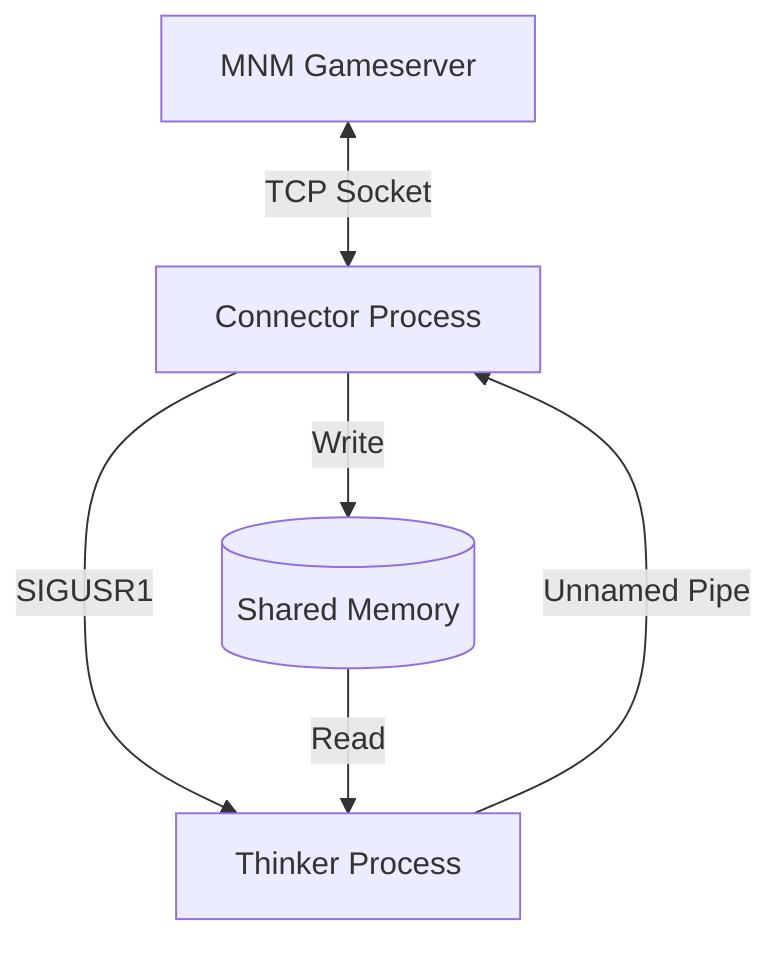

# Reversi – Systempraktikum LMU München


## 1. Projektübersicht

Dieses Repository beinhaltet die Entwicklung eines 
Reversi-Clients in der Programmiersprache C im Rahmen 
des Systempraktikums an der Ludwig-Maximilians-Universität 
München (LMU) im Wintersemester 2026/27.

Ziel des Projekts ist die Implementierung eines autonomen, 
netzwerkfähigen Spielclients, welcher mit dem 
MNM-Gameserver kommuniziert, Spielzustände verarbeitet 
und mithilfe einer algorithmischen Spielstrategie 
gültige und möglichst optimale Spielzüge berechnet.

## 2. Projektinformationen

| Kategorie | Beschreibung |
|---|---|
| Universität | LMU München |
| Veranstaltung | Systempraktikum |
| Semester | Wintersemester 2026/27 |
| Projektgruppe | Gruppe 3 |
| Programmiersprache | C |
| Zielplattform | Linux / UNIX |
| Build-System | GNU Make |
| Versionsverwaltung | Git / GitHub |
| Abgabedatum | 07.02.2027 |

## 3. Spielbeschreibung

Reversi ist ein strategisches Brettspiel für zwei Spieler, 
welches üblicherweise auf einem 8 × 8 großen Spielfeld 
gespielt wird.

Die Spieler setzen abwechselnd schwarze und weiße 
Spielsteine auf das Spielfeld. Dabei werden gegnerische 
Spielsteine umgedreht, wenn diese zwischen eigenen 
Spielsteinen eingeschlossen werden.

Ziel des Spiels ist es, am Ende der Partie mehr 
Spielsteine als der Gegner zu besitzen.

### Initialer Spielzustand

    A B C D E F G H
  +-----------------+
1 | . . . . . . . . | 1
2 | . . . . . . . . | 2
3 | . . . . . . . . | 3
4 | . . . W B . . . | 4
5 | . . . B W . . . | 5
6 | . . . . . . . . | 6
7 | . . . . . . . . | 7
8 | . . . . . . . . | 8
  +-----------------+
    A B C D E F G H

- B: Schwarzer Spielstein
- W: Weißer Spielstein
- .: Freies Spielfeld

## 4. Systemarchitektur

Der Client besteht aus zwei eigenständigen Prozessen:

### Connector

- Aufbau einer TCP-Verbindung zum Gameserver
- Implementierung des Kommunikationsprotokolls
- Empfang und Verarbeitung der Spielinformationen
- Speicherung der Spielzustände im Shared Memory
- Signalisierung an den Thinker
- Übermittlung berechneter Spielzüge an den Gameserver

### Thinker

- Auslesen der Spielinformationen aus dem Shared Memory
- Analyse des aktuellen Spielzustands
- Ermittlung gültiger Spielzüge
- Bewertung möglicher Spielstrategien
- Berechnung eines geeigneten Spielzugs
- Rückgabe des Spielzugs über eine Pipe

### Architekturdiagramm



## 5. Technische Konzepte

| Technologie | Verwendung |
|---|---|
| C | Systemnahe Programmierung |
| TCP/IP | Netzwerkkommunikation |
| Sockets | Verbindung zum Gameserver |
| fork() | Erzeugung eines Kindprozesses |
| Shared Memory | Gemeinsame Spielinformationen |
| Pipes | Übertragung berechneter Spielzüge |
| UNIX Signals | Kommunikation zwischen Prozessen |
| select() | Überwachung von Filedeskriptoren |
| Makefile | Automatisierung der Kompilierung |
| Valgrind | Speicheranalyse und Fehlererkennung |
| Git | Versionsverwaltung |

## 6. Projektstruktur

Vorgesehene modulare Verzeichnisstruktur:

```text
Reversi/
├── src/
│   ├── main.c
│   ├── connector.c
│   ├── performConnection.c
│   ├── thinker.c
│   ├── config.c
│   ├── shared_memory.c
│   ├── reversi.c
│   └── ai.c
├── include/
│   ├── connector.h
│   ├── performConnection.h
│   ├── thinker.h
│   ├── config.h
│   ├── shared_memory.h
│   ├── reversi.h
│   └── ai.h
├── tests/
├── docs/
├── client.conf
├── Makefile
├── .gitignore
└── README.md
```

## 7. Installation und Ausführung

### Voraussetzungen

- Linux-Umgebung
- GCC oder Clang
- GNU Make
- Git
- Valgrind (für Speicheranalysen)
- Zugang zum Münchner Wissenschaftsnetz (MWN)

### Repository klonen

```bash
git clone <REPOSITORY-URL>
cd Reversi
```

### Kompilierung

```bash
make
```

### Programm starten

```bash
./sysprak-client -g <GAME-ID> -p <PLAYER> -c client.conf
```

| Parameter | Beschreibung |
|---|---|
| -g | 13-stellige Game-ID |
| -p | Spielernummer (1 oder 2) |
| -c | Pfad zur Konfigurationsdatei |

### Konfigurationsdatei

Die Datei `client.conf` enthält die Verbindungsparameter:

```ini
Hostname = sysprak.priv.lab.nm.ifi.lmu.de
PortNumber = 1357
GameKindName = Reversi
```

## 8. Meilensteine

| Meilenstein | Beschreibung | Geplanter Abschluss |
|---|---|---|
| MS00 | Einführung und Projektplanung | 22.11.2026 |
| MS01 | TCP-Verbindung und Prolog | 29.11.2026 |
| MS02 | Prozesse, Konfiguration und Shared Memory | 13.12.2026 |
| MS03 | Vollständiges Protokoll und IPC | 20.12.2026 |
| MS04 | Spielstrategie und künstliche Intelligenz | 17.01.2027 |
| Code-Freeze | Optimierung und abschließende Tests | 31.01.2027 |
| Abgabe | Finale Projektabgabe | 07.02.2027 |

## 9. Spielstrategie und künstliche Intelligenz

Für die Berechnung möglichst optimaler Spielzüge 
sind folgende Verfahren vorgesehen:

- Generierung gültiger Spielzüge
- Heuristische Spielfeldbewertung
- Bewertung strategisch wichtiger Eckfelder
- Mobilitätsanalyse
- Minimax-Algorithmus
- Optimierung der Zugsortierung
- Endspieloptimierung
- Zeitbudgetverwaltung
- Fallback-Strategie bei Zeitbeschränkungen

## 10. Qualitätssicherung

Die Entwicklung erfolgt unter Berücksichtigung 
folgender Qualitätsanforderungen:

- Modularer und verständlicher Quellcode
- Dokumentierte Funktionsschnittstellen
- Robuste Fehlerbehandlung
- Keine Compilerwarnungen mit -Wall und -Wextra
- Vermeidung von Memory Leaks
- Ordnungsgemäße Freigabe von Systemressourcen
- Vermeidung von Zombie- und Waisenprozessen
- Regelmäßige Code-Reviews
- Integrationstests mit dem Gameserver

### Speicheranalyse

```bash
valgrind --leak-check=full \
         --show-leak-kinds=all \
         --trace-children=yes \
         ./sysprak-client -g <GAME-ID> -p 1 -c client.conf
```

## 11. Git-Workflow

| Branch | Funktion |
|---|---|
| main | Stabiler Entwicklungsstand |
| feature/* | Entwicklung einzelner Funktionen |
| fix/* | Fehlerbehebung |
| abgabe | Finale Projektabgabe |

Änderungen werden in separaten Branches entwickelt 
und nach erfolgreichem Code-Review über Pull Requests 
in den main-Branch integriert.

## 12. Projektteam

**Gruppe 3 – Systempraktikum WS 2026/27**

- Zexi Gabriel Wang
- Daniela Ungurean
- Lukas Fodor
- Jonas Hilbig

## 13. Projektstatus

Das Projekt befindet sich derzeit in der Entwicklung.

## 14. Akademischer Kontext

Dieses Projekt entsteht im Rahmen des Systempraktikums 
am Institut für Informatik der 
Ludwig-Maximilians-Universität München.

Es dient der praktischen Anwendung von Konzepten 
der Systemprogrammierung, Betriebssysteme, 
Netzwerkkommunikation und Softwareentwicklung.
